# Neural Style Transfer

A TensorFlow implementation of neural style transfer based on ["A Neural Algorithm of Artistic Style"](https://arxiv.org/pdf/1508.06576.pdf) by Gatys et al. (2015).

This was my final project for CSE 455 - Computer Vision at the University of Washington.

## Overview

This project transfers the artistic style of one image onto the content of another while preserving the underlying structure. It uses pre-trained convolutional neural networks (VGG16/VGG19) to extract content and style features, then optimizes a generated image to minimize a combined loss function.

## Installation

```bash
git clone https://github.com/joshuaswanson/neural-style-transfer.git
cd neural-style-transfer
uv sync
```

## Usage

```bash
uv run main.py
```

The script will process all images in the `contents/` directory with all styles from `styles/`, saving results to `output/`.

### Options

| Flag | Default | Description |
|------|---------|-------------|
| `--models` | `VGG16 VGG19` | Any of `VGG16`, `VGG19`, `InceptionV3`, `ResNet50`, `EfficientNetB0` |
| `--alpha` | 5 | Content loss weight |
| `--beta` | 1 | Style loss weight |
| `--variation-weight` | 30 | Total variation loss weight (smoothness) |
| `--iterations` | 1000 | Optimization iterations |
| `--learning-rate` | 5.0 | Adam learning rate |
| `--contents`, `--styles`, `--output` | `contents/`, `styles/`, `output/` | Image directories |

Example:

```bash
uv run main.py --models VGG19 --iterations 500 --beta 2
```

## Project Structure

```
neural-style-transfer/
├── main.py              # Command-line entry point
├── models.py            # CNN backbones and feature layers
├── style_transfer.py    # Core optimization loop
├── utils.py             # Image I/O and loss functions
├── contents/            # Content images
├── styles/              # Style images
├── output/              # Generated results
└── README.md
```

## Approach

The implementation follows the methodology outlined by Gatys et al.:

1. **Preprocessing:** Load and resize images. The generated image is optimized in RGB pixel space, and model-specific preprocessing is applied inside the loss
2. **Feature Extraction:** Use pre-trained VGG networks (without fully connected layers) to extract features
3. **Content Loss:** Compare feature maps at deep layers between content and generated images
4. **Style Loss:** Compare Gram matrices of feature maps at multiple layers between style and generated images
5. **Optimization:** Minimize total loss (content + style + variation) using Adam optimizer
6. **Postprocessing:** Clip the generated image to [0, 255] and save it

### Loss Function

The total loss combines three components:

- **Content Loss:** MSE between content and generated feature representations
- **Style Loss:** MSE between Gram matrices of style and generated feature maps
- **Variation Loss:** Total variation regularization for spatial smoothness (extension beyond original paper)

## Dataset

### Content Images

<p>
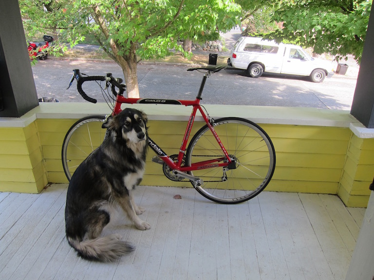
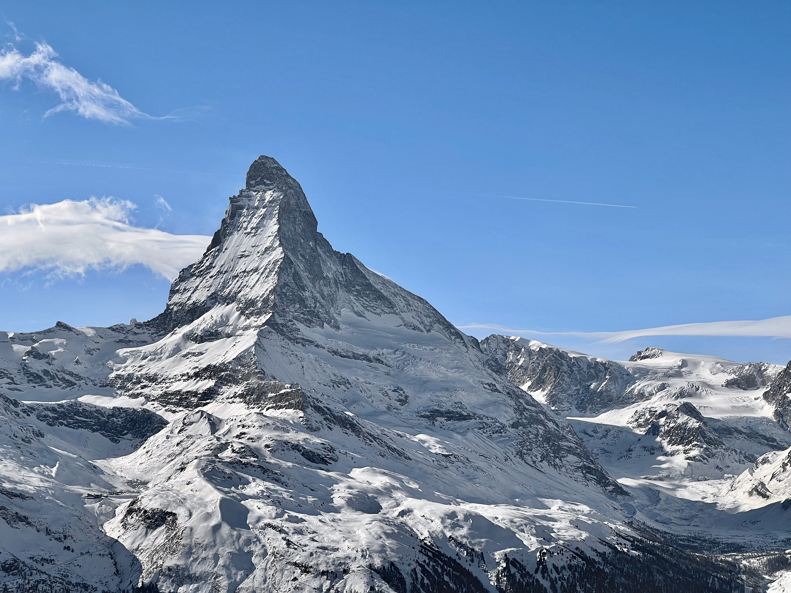

</p>

### Style Images

<p>
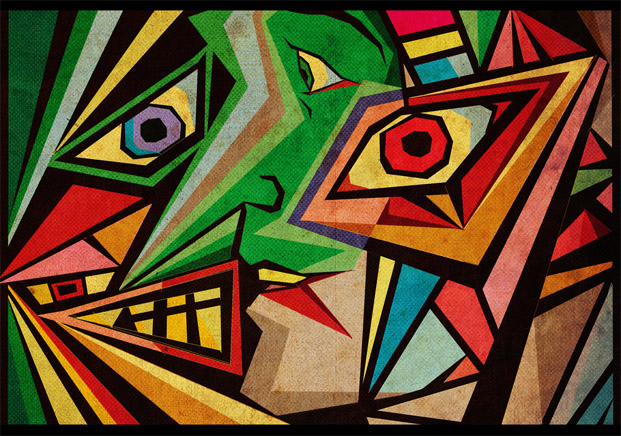
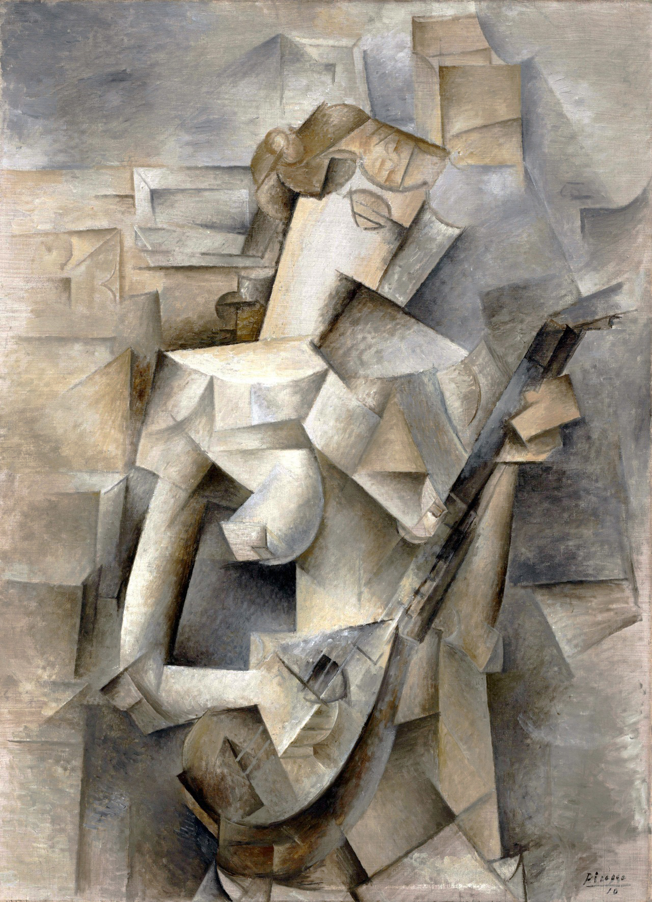
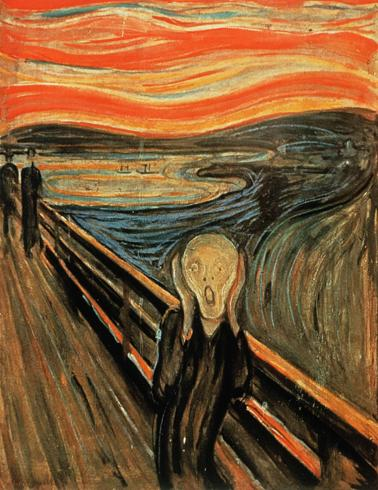
</p>
<p>
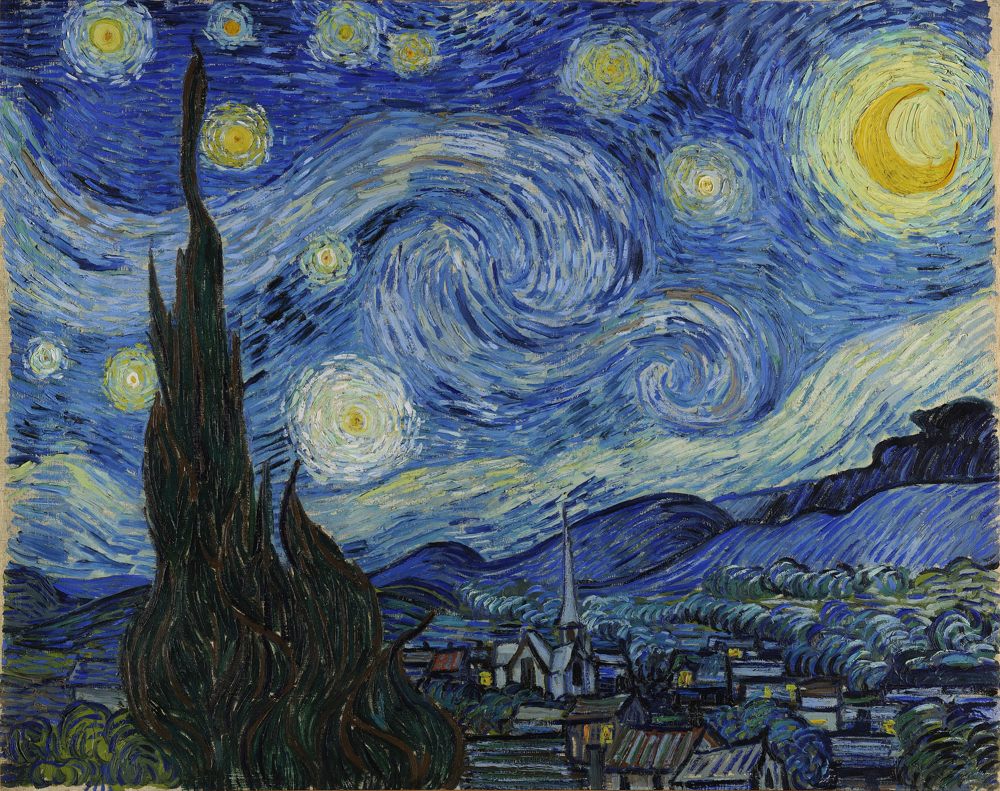
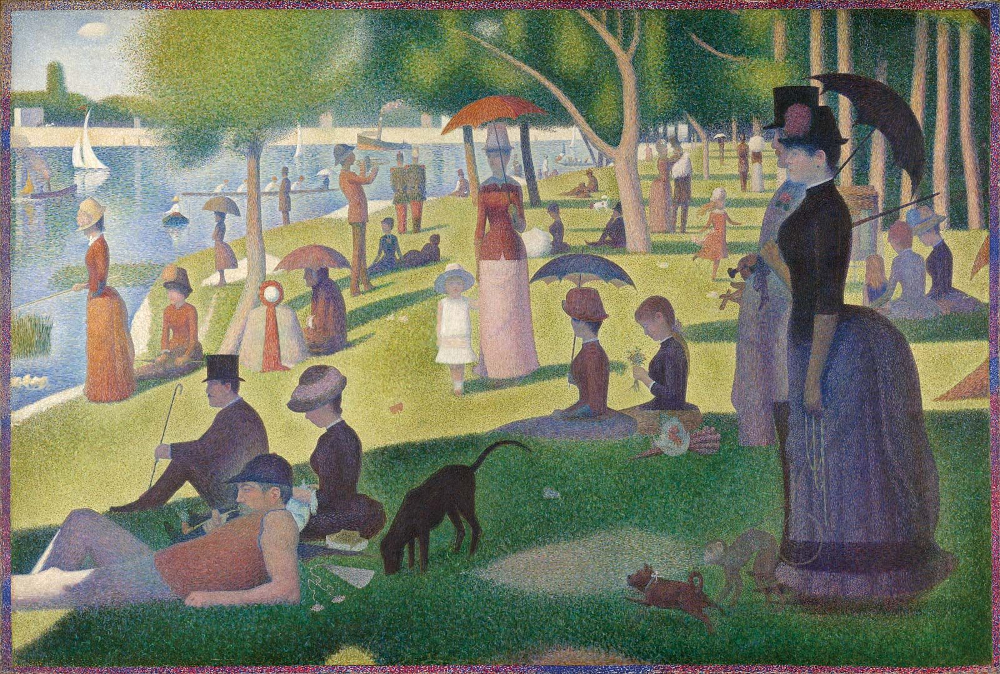
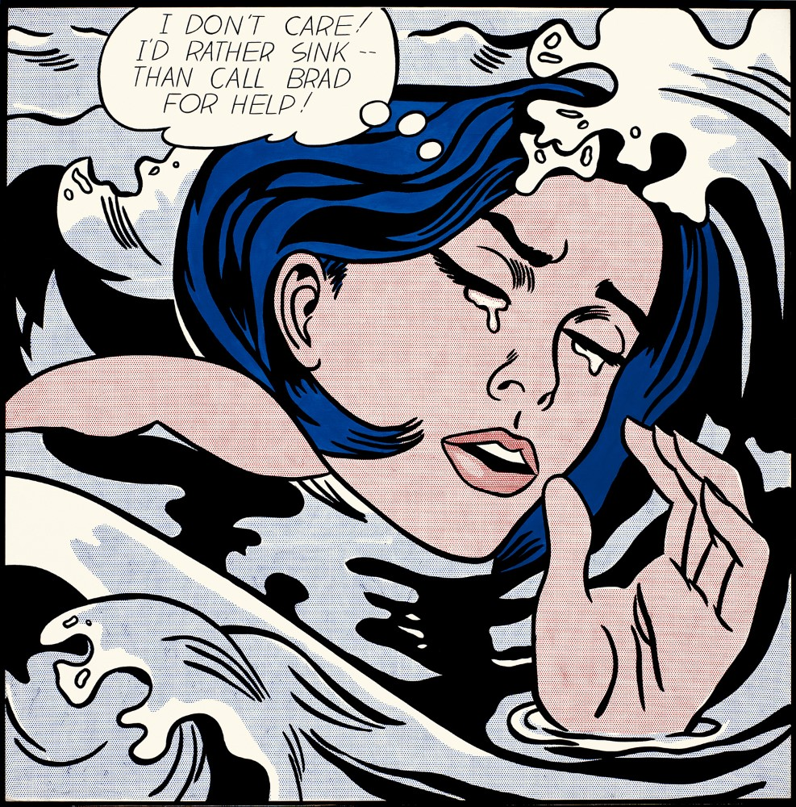
</p>

## Results

### VGG-16 Results

**Unknown Picasso**
<p>
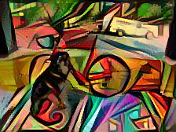
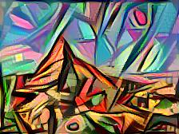
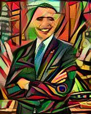
</p>

**Girl with a Mandolin**
<p>
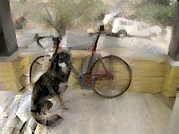
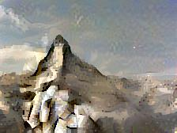
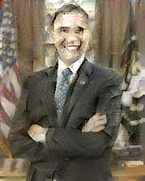
</p>

**The Scream**
<p>
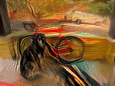
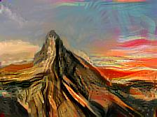
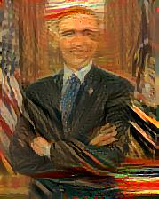
</p>

**The Starry Night**
<p>
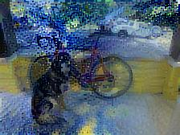
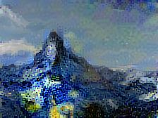
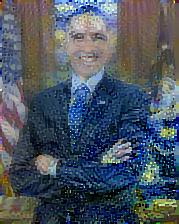
</p>

**A Sunday on La Grande Jatte**
<p>
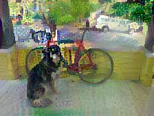
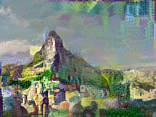
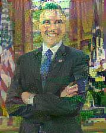
</p>

**Drowning Girl**
<p>
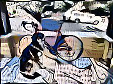
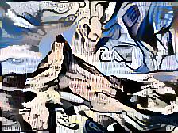
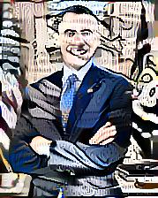
</p>

### VGG-19 Results

**Unknown Picasso**
<p>
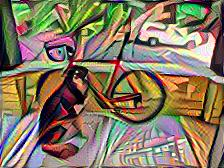
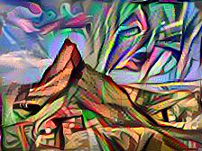
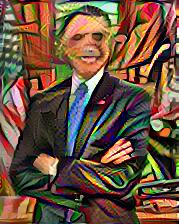
</p>

**Girl with a Mandolin**
<p>
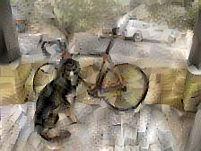
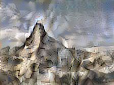
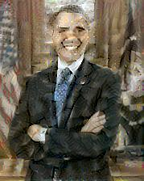
</p>

**The Scream**
<p>
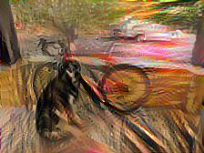
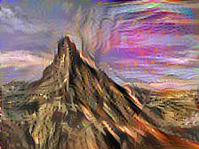
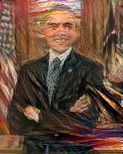
</p>

**The Starry Night**
<p>
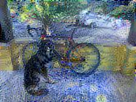
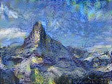
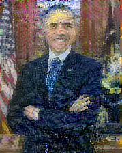
</p>

**A Sunday on La Grande Jatte**
<p>
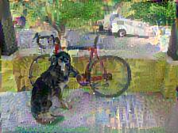
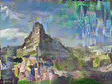
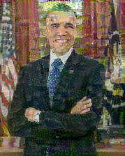
</p>

**Drowning Girl**
<p>
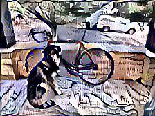
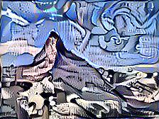

</p>

## Discussion

### Challenges

The primary challenge was memory management. Processing larger images or using alternative architectures (InceptionV3, ResNet50, EfficientNetB0) caused system memory exhaustion. Output images are consequently limited in resolution.

### Novel Contributions

1. **Variation Loss:** Added total variation regularization (not in original paper) to reduce high-frequency noise
2. **VGG-16 Comparison:** Most implementations use only VGG-19; this project compares both architectures
3. **Multi-Architecture Support:** Framework supports multiple CNN architectures (though memory limits practical use)

### Future Work

- Implement memory optimization techniques
- Experiment with different layer selections for VGG-16
- Explore Cycle-Consistent GANs for style transfer

## References

- [A Neural Algorithm of Artistic Style (Gatys et al., 2015)](https://arxiv.org/pdf/1508.06576.pdf)
- [Neural Networks Intuitions: Dot product, Gram Matrix and Neural Style Transfer](https://towardsdatascience.com/neural-networks-intuitions-2-dot-product-gram-matrix-and-neural-style-transfer-5d39653e7916)
- [Intuitive Guide to Neural Style Transfer](https://towardsdatascience.com/light-on-math-machine-learning-intuitive-guide-to-neural-style-transfer-ef88e46697ee)
- [Neural Style Transfer using VGG model](https://towardsdatascience.com/neural-style-transfer-using-vgg-model-ff0f9757aafc)
- [Neural Style Transfer - Dive Into Deep Learning](https://d2l.ai/chapter_computer-vision/neural-style.html)
- [Neural style transfer - TensorFlow Tutorial](https://www.tensorflow.org/tutorials/generative/style_transfer)
